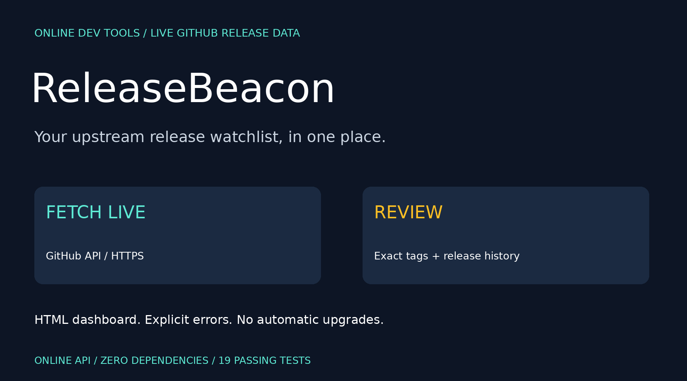
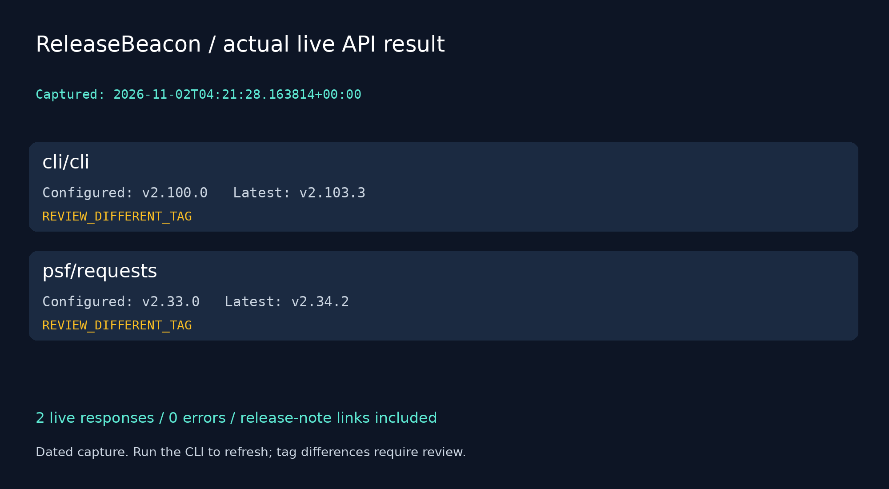

# ReleaseBeacon



  

**One watchlist. Live releases. Clear review signals.**

ReleaseBeacon fetches the latest non-draft, non-prerelease release exposed by GitHub's latest-release API for each repository in a watchlist. It compares exact configured tags, remembers release IDs between runs, and generates a local HTML dashboard and/or JSON report.

This is an **online tool**: every check calls GitHub over HTTPS. Opening an already generated dashboard does not refresh its data; run the CLI again to update it. No packages, releases or binaries are downloaded or installed.

## Quick start

Python 3.10+ with working HTTPS connectivity; no pip packages required. Download or clone this repository and open its directory:

```bash
python3 releasebeacon.py watchlist.json --html dashboard.html
python3 releasebeacon.py watchlist.json --json
python3 releasebeacon.py watchlist.json --check
python3 -m unittest discover -v
```

On Windows use `py -3` if needed. Open `dashboard.html` locally in your browser after the command finishes. The program atomically replaces its state and HTML output files on subsequent checks, so choose dedicated paths.

## Watchlist

```json
{
  "repositories": [
    {"repo": "cli/cli", "current": "v2.100.0"},
    {"repo": "psf/requests", "current": "v2.33.0"},
    {"repo": "pallets/flask"}
  ]
}
```

`current` is an optional **exact release tag you supply**, not an automatically detected installed version. Example tags are illustrative inventory values, not claims about your device. Omit it to track a project without comparing a local version. The watchlist supports 1–20 unique `owner/name` entries and rejects case-insensitive duplicates and URL/path injection characters.

## Status meanings

| Status | Meaning |
| --- | --- |
| `TAG_MATCH` | Configured string exactly equals the latest tag returned by GitHub |
| `REVIEW_DIFFERENT_TAG` | Strings differ; review upstream notes before deciding what to do |
| `TRACKING` | Latest release fetched, but no current tag was configured |
| `ERROR` | Request or release validation failed; no stale result is shown as current |

`v2.0`, `2.0`, a commit hash and a package-manager version are different strings. This prototype does **not** sort semantic versions, prove a new tag is newer than yours, recommend an upgrade, scan vulnerabilities or resolve dependencies. GitHub's latest-release choice is used as-is; projects without a visible latest release return an error even if they have tags.

## History

The default `.releasebeacon-state.json` stores only repository names and last successfully observed release IDs. Use `--state` to choose another file:

```bash
python3 releasebeacon.py watchlist.json --state team-state.json --html team-dashboard.html
```

- First observation: `changed_since_previous` is `null`.
- Same release ID: `false`.
- Different release ID: `true`.
- Failed requests preserve their previous state but return an error row without cached release metadata.

This detects a changed latest release identity, not every intermediate release. Edits to notes or a tag on the same release ID are not classified as a new release. State keys are case-normalized. Do not run multiple writers against the same state file: writes are atomic but there is no process lock or merge protocol.

## Network, privacy and rate limits

Each repository causes one request to the fixed HTTPS host `api.github.com`; up to four requests run concurrently. Default timeout is 15 seconds per request (`--timeout 1` through `--timeout 60`). Responses are capped at 2 MB, and HTTP redirects are refused, including redirects for moved repositories. Update renamed repositories explicitly.

Public repositories can be checked without a token, subject to GitHub's API limits. An optional `GITHUB_TOKEN` environment variable adds an Authorization header for that API host. Do not put tokens in the watchlist, reports, source code or shell history. The program never stores or prints the token, does not request new permissions and does not follow redirects with it. Use a token only if you need it, with the smallest suitable access.

GitHub sees the repository requests and normal network metadata. No OpenAI API key, paid resource, hosted service, telemetry endpoint or external database is required by this program. API availability and limits still apply. HTTP 403/429 is reported as rate-limit/access restriction; there is no automatic retry loop. If checking fails, the CLI returns 2 and still reports other successful repositories.

The generated HTML contains escaped metadata and verified HTTPS release links, no JavaScript and no remote assets. Release notes are linked, not copied or rendered from remote Markdown. Reports/watchlists may reveal private repository names if you configure them; included fixtures use public metadata only.

## Outputs and exits

```bash
python3 releasebeacon.py watchlist.json --json > report.json
python3 releasebeacon.py watchlist.json --html dashboard.html --check
```

Config, state and HTML paths must differ. Output symlinks are refused. Parent directories must already exist. Shell redirection is controlled by your shell, so avoid redirecting over an input or state file. HTML/state are separate atomic writes, not one transaction; an output failure can leave one refreshed before the other.

| Exit | Meaning |
| --- | --- |
| 0 | Successful check without selected review changes |
| 1 | `--check` found a different configured tag or a changed release ID |
| 2 | One or more fetches failed, or config/state/output was invalid |

Without `--check`, tag differences do not cause exit 1. Network errors take priority and return 2. Terminal tags and errors are JSON-quoted to avoid control characters in upstream values.

## Live validation snapshot

On **2026-11-02**, the actual CLI fetched `cli/cli` and `psf/requests` with **two successful live responses and zero errors**. The capture is timestamped in UTC in:

- [Live JSON report](examples/live-report.json)
- [Generated HTML dashboard](examples/live-dashboard.html) — download to view locally

These files are snapshots, not continuously updated content. Run the command to retrieve current data. A subsequent live repeat encountered request failures and correctly returned exit 2 without presenting cached releases as successful current fetches; its previous successful history was preserved. Network availability can vary. Development validation also used mocked responses for HTTP 404, rate limits, timeouts, malformed metadata and size limits. No live rate-limit exhaustion or private-token test was performed.

## Tests

19 standard-library tests cover repository/config validation, duplicates, a valid HTTP response, fixed request host and synthetic auth header, missing releases, rate limits, network failures, oversized responses, unsafe release links, prerelease rejection, tag matching, changed history, preserving history on failure, HTML escaping, atomic output replacement, invalid state and CLI error exits.

## Limits

No package discovery, SemVer ordering, changelog summarization, binary download, dependency updates, push notifications or automatic polling scheduler. Run it manually or invoke it with your own scheduler. It currently supports GitHub.com release metadata only, not GitHub Enterprise, npm/PyPI registry version APIs or all Git tags. A network timeout bounds individual operations; total runtime can exceed the timeout across several repositories.

API reference: [GitHub release endpoints](https://docs.github.com/en/rest/releases/releases).

## Launch kit



[Arabic and English launch drafts](POST.md).

Suggested topics: `github-api`, `release-monitor`, `developer-tools`, `python`, `dashboard`, `cli`, `version-tracking`.
